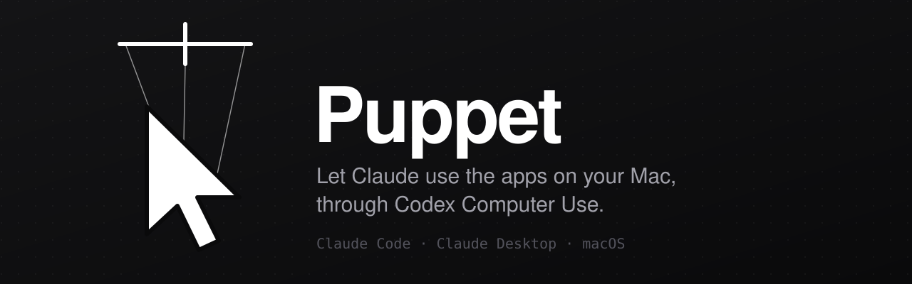
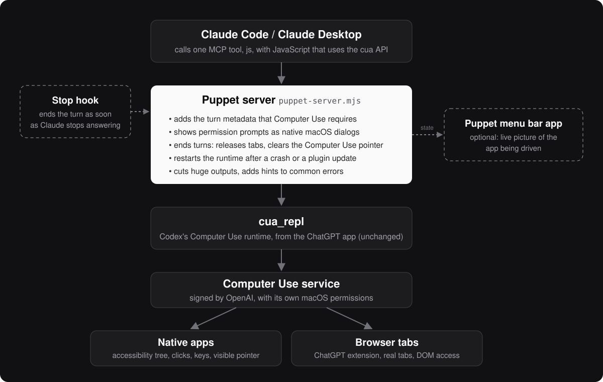

<p align="center">
  
</p>

<p align="center">
  
  
  
  
</p>

**Puppet** lets Claude use the apps on your Mac. It connects Claude Code and Claude Desktop to **Codex Computer Use**, the computer-use engine that ships with the ChatGPT desktop app, so Claude can click, type and read in your real native apps and in your real browser tabs, with your existing sign-ins.

Puppet does not redistribute anything from OpenAI. It runs the copy of Computer Use already installed by your ChatGPT app and adds what Claude needs to use it well.

```text
You:     Open Mail and tell me if I got anything important today.
Claude:  (opens Mail, reads the inbox list)
         Two messages stand out: a security notice from GitHub and ...
```

## Features

- **Native apps and browser tabs.** Any Mac app through its accessibility tree (clicks, keys, text, menus), and real tabs in Chrome or another Chromium browser through the ChatGPT extension, with DOM access.
- **Works in Claude Code and Claude Desktop.** One MCP server, `puppet`, with the same two tools as Codex: `js` and `js_reset`.
- **Clean turns.** When Claude finishes answering, Puppet ends the Computer Use turn: claimed tabs are released and the Computer Use pointer leaves your screen.
- **Native permission dialogs.** Computer Use asks before it uses an app or a site. Puppet shows those requests as macOS dialogs instead of letting a headless host decline them silently, and can remember the apps you always allow.
- **Resilient.** It follows ChatGPT updates on its own, restarts the runtime after a crash, cuts oversized outputs before they flood Claude's context, and adds a hint to common errors.
- **Watch it work (optional).** A small menu bar app shows a live picture of the app being driven, in a floating picture-in-picture window, and disappears when Computer Use is idle.
- **A skill for Claude.** Working habits that keep outputs small, avoid typing into your open documents and follow Codex's confirmation policy.

## How it works

<p align="center">
  
</p>

The ChatGPT desktop app installs Codex's computer-use MCP server, `cua_repl`. Claude could launch it directly for native apps, but its browser backend requires per-call Codex session metadata that only Codex sends, and several of its behaviors (turn ends, permission prompts) assume a Codex client.

`puppet-server.mjs` sits between Claude and `cua_repl` and fills those gaps:

- **Follows Codex updates.** On every start it reads the newest `~/.codex/plugins/cache/openai-bundled/unified-computer-use/<version>/.mcp.json` and launches `cua_repl` exactly as described there, after checking that its Node binary is signed by OpenAI. Between turns it switches to a newer plugin version when one appears.
- **Adds the turn metadata** (`session_id`, `turn_id`) to every call. One Claude session is one Codex session. A turn ends when Claude finishes answering (Stop hook) or after one idle minute.
- **Ends turns the way Codex does.** It sends `turn_ended` to `cua_repl`, which releases browser tabs, and runs `SkyComputerUseClient turn-ended`, which makes the Computer Use service hide its pointer. If a server was killed before doing so, the next start ends the orphaned turn.
- **Shows permission prompts** as native dialogs (Allow, Always Allow, Deny) and remembers session approvals.
- **Recovers from kernel resets** (a timed-out call or `js_reset`) by ending the turn, which frees any tab left half-attached.
- **Exposes the same tools as Codex**, filtered by the plugin's own `enabled_tools`.

## Requirements

- **macOS 14 or later.**
- **The ChatGPT desktop app** with Codex Computer Use set up: open Codex, turn on Computer Use, and grant the macOS permissions it asks for (Accessibility, Screen Recording).
- **The ChatGPT browser extension**, only to drive browser tabs. It works in Chrome and in other Chromium browsers such as Vivaldi, Brave or Edge.
- **Node.js 18+**, preferably from Homebrew (`brew install node`).
- **Claude Code** (`claude` on your `PATH`), and optionally **Claude Desktop**.

## Install

### Option 1: with the install script (recommended)

```sh
git clone https://github.com/tofunori/puppet.git
cd puppet
./install.sh --no-claude-md
```

Then restart Claude Code. The script checks the requirements, copies the server to `~/.claude/mcp/`, registers the user-scoped MCP server `puppet`, copies the `puppet` skill to `~/.claude/skills/puppet/`, and checks that the server connects. Running it again is safe; run it again after each `git pull`.

| Option | Effect |
| --- | --- |
| `--desktop` | Also adds `puppet` to Claude Desktop's `claude_desktop_config.json`, after a timestamped backup and without touching your other servers. Quit Claude Desktop first (Cmd+Q) and run the script from Terminal: Desktop writes that file back from memory, which would undo the change. |
| `--menubar` | Builds the menu bar app into `~/Applications/Puppet.app`, starts it, and starts it at login. Needs the Xcode command line tools. |
| `--no-skill` | Skips the skill. |
| `--no-claude-md` | Skips adding a short rule to `~/.claude/CLAUDE.md` (between `<!-- puppet:begin -->` and `<!-- puppet:end -->`) that tells Claude to prefer Puppet over other computer-use tools. Leave this option out if you want that rule. |

#### End the turn as soon as Claude finishes (Claude Code)

The script also installs `~/.claude/mcp/puppet-end-turn.mjs`. Run from a Claude Code `Stop` hook, it tells that session's server to end the turn at once, so tabs are released and the pointer goes away as soon as Claude stops answering, instead of after the idle minute. The script does not edit your settings; add this entry to the `"Stop"` list under `"hooks"` in `~/.claude/settings.json` (use the Node path the script printed):

```json
{ "hooks": [{ "type": "command", "command": "\"/opt/homebrew/bin/node\" \"$HOME/.claude/mcp/puppet-end-turn.mjs\"", "timeout": 10 }] }
```

Claude Desktop chats have no hooks; there the turn ends after the idle minute.

### Option 2: as a Claude Code plugin

```text
/plugin marketplace add tofunori/puppet
/plugin install puppet@puppet
```

The plugin brings the MCP server, the Stop hook and the skill, without touching your settings. Its tools are named `mcp__plugin_puppet_puppet__js` and `mcp__plugin_puppet_puppet__js_reset`. Claude Desktop does not load Claude Code plugins, and the menu bar app is not included; use the script for those. Use the plugin or the script, not both.

## Use

Ask Claude for anything that needs your Mac's interface:

- "Open System Settings and tell me which Wi-Fi network I'm on."
- "In my browser, open my site's dashboard and check for new sign-ups."
- "Write a test email to myself from Outlook."
- "Open Notes and read me the last note."

The first time Claude uses an app or a site, a dialog asks for permission:

| Button | Effect |
| --- | --- |
| **Allow** | For the rest of the Claude session (apps, and browser prompts that offer it); otherwise this time only. |
| **Always Allow** | Saved. For apps, Puppet keeps the choice in `~/.claude/mcp/puppet-approvals.json`, since Computer Use does not. |
| **Deny** | Declined for the rest of the session. |

The dialog shows what Computer Use sends with the request: the app or site, any warning and the risk level. A high-risk request uses a critical alert. Press **Esc** at any time to stop an action in progress.

To allow every app without being asked, write this in `~/.claude/mcp/puppet-approvals.json`. Browser prompts (camera, downloads, signing in) and high-risk prompts still ask.

```json
{ "allApps": true }
```

## Menu bar app

`./install.sh --menubar` builds **Puppet.app**, a small optional companion:

- Its icon, a plain arrow in the menu bar's own color, appears only while Computer Use is active and ten seconds after. It gains rays while an action runs. To reach its menu while it is hidden, open Puppet again from Spotlight: the icon stays for 30 seconds.
- Click the icon for a live picture of the window being driven.
- During a turn, a floating window in the top-right corner shows the same picture, like Codex's picture-in-picture. It never takes focus; drag it to move it, pull its left or bottom edge to resize it.
- Right-click for settings (floating window on, off or always shown), to end a session's turn, or to quit.

The live picture uses ScreenCaptureKit and needs the Screen Recording permission (System Settings > Privacy & Security > Screen Recording). Images stay in memory. Without that permission, the app falls back to the picture the server asks the Computer Use service for after each action. `menubar/build.sh` signs the app with your first "Apple Development" identity (or `PUPPET_SIGN_IDENTITY`) so the permission survives rebuilds.

Clicks in a browser tab happen inside the page, so no pointer moves on screen there; the picture still follows the page. In native apps you see the Computer Use pointer move.

## Configuration

Set these variables before running `./install.sh`; they are saved into the MCP server config. With the plugin, set them in the environment Claude Code starts from instead.

| Variable | Default | Effect |
| --- | --- | --- |
| `PUPPET_IDLE_TURN_MS` | `60000` | Idle time after which the turn ends, tabs are released and the pointer is cleared. |
| `PUPPET_MAX_OUTPUT_CHARS` | `80000` | Longer `js` results are cut; the full text goes to a private file in `$TMPDIR/puppet-output/` (kept one day) whose path ends the result. |
| `PUPPET_SANDBOX` | on | `off` runs the `js` code without Codex's sandbox, as Codex does in `danger-full-access`. With the sandbox, that code sees the disk read-only and has no network; apps and tabs work either way. |
| `PUPPET_DISABLE_ANALYTICS` | off | `1` stops `cua_repl`'s JavaScript from sending usage events to OpenAI. The Computer Use app's own events remain. |
| `PUPPET_HELPERS` | on | `0` stops the server from declaring the `cuFind`, `cuLines` and `cuKey` helpers in each new kernel. |
| `PUPPET_SNAPSHOTS` | on | `0` stops the server from asking for a picture of the app after each action (used by the menu bar app). |
| `PUPPET_NATIVE_PROMPTS` | on | `0` forwards permission prompts to the MCP client instead of showing a macOS dialog. |
| `PUPPET_DATA_DIR` | `~/.claude/mcp` | Where `puppet-approvals.json` lives, for both the script and the plugin. |
| `PUPPET_NODE` | Homebrew's `node` | The Node.js binary written into the MCP config. |
| `CODEX_HOME` | `~/.codex` | Where to find the Codex plugin cache. |

```sh
PUPPET_IDLE_TURN_MS=30000 ./install.sh --no-claude-md
```

## Troubleshooting

Start with `node doctor.mjs` (or `npm run doctor`) from your checkout; it is written for script installs. Without changing anything, it checks the Codex plugin and its signature, the Computer Use service, the browser extension, the installed server against your checkout, the Claude Code and Claude Desktop registrations, the Stop hook, the skill and the running sessions, and prints a fix for each problem.

| Symptom | What to do |
| --- | --- |
| `claude mcp get puppet` is not connected | Read its error. Usually the ChatGPT app moved or Computer Use is not set up yet; run `./install.sh` again for a requirements check. |
| `Missing required Codex turn metadata` | Claude is launching `cua_repl` directly instead of Puppet. Run `./install.sh` again. |
| `Tab … is already part of browser session …` | Another Claude session (or Codex) holds that tab. It is released when that session finishes answering, idles one minute, or exits. |
| `Debugger unattached` on a tab | The browser service stopped while attaching. Puppet ends the turn after the reset; take the tab again. Keep slow multi-page steps in separate `js` calls. |
| Browser calls fail but apps work | Install the ChatGPT extension in your browser and keep the browser running. |
| A permission was denied by mistake | Denials last for the session. Restart Claude Code, or reconnect `puppet` with `/mcp`. |
| No live picture in the menu bar app | Allow Puppet in Screen Recording, then open it again. |

The server logs to stderr with a `[puppet]` prefix; `claude --debug` shows them in Claude Code's MCP logs.

## Coming from codex-cu

Puppet was called `codex-cu` before. `./install.sh` replaces that install: it unregisters `codex-cu`, copies your app approvals, removes the old rule from `~/.claude/CLAUDE.md`, the old skill and the old menu bar app. If you used the `codex-cu` plugin, run `/plugin uninstall codex-cu@codex-cu` and `/plugin marketplace remove codex-cu` first. Your tools become `mcp__puppet__js` and `mcp__puppet__js_reset`. If your `Stop` hook runs `codex-cu-end-turn.mjs`, point it to `puppet-end-turn.mjs`. For Claude Desktop, quit it and run `./install.sh --desktop`.

## Development

```sh
npm test       # the server against a fake cua_repl, in temporary folders
npm run doctor # checks a real install, read-only
```

The tests never touch `~/.claude` or the real Computer Use service; they set `PUPPET_SKIP_SIGNATURE_CHECK=1`, which only makes sense with their fake server. They cover the pre-initialize probe, the turn metadata, idle and Stop-hook turn ends, crash restarts, plugin updates, the signature check, saved app approvals, snapshots and concurrent state-file writes.

## Uninstall

```sh
./uninstall.sh
```

This removes the MCP server, the installed files (including your saved app approvals), the skill, the menu bar app and the managed block in `~/.claude/CLAUDE.md`. Remove these yourself if you added them: the `puppet` entry in Claude Desktop's config, the `Stop` hook in `~/.claude/settings.json`, and the plugin (`/plugin uninstall puppet@puppet`).

## Caveats

- **Undocumented internals.** Puppet relies on undocumented behavior of OpenAI's bundled computer-use plugin (the `x-codex-turn-metadata` field, `turn_ended`, the plugin cache layout). A ChatGPT update can break it; you then get a clear error rather than silent misbehavior.
- **Unofficial.** Not affiliated with or endorsed by OpenAI or Anthropic. Codex, ChatGPT, Claude and Claude Code are trademarks of their owners. Your use of Computer Use stays subject to OpenAI's terms.
- **Real apps, real accounts.** Claude acts with your sign-ins. Keep the confirmation dialogs on for anything you would not do without looking, and press Esc to stop.
- **macOS only.**

## Credits

Puppet grew out of [shiptomorrow/claude-codex-computer-use](https://github.com/shiptomorrow/claude-codex-computer-use), which first showed how to run Codex Computer Use from Claude Code.

## License

[MIT](LICENSE)
